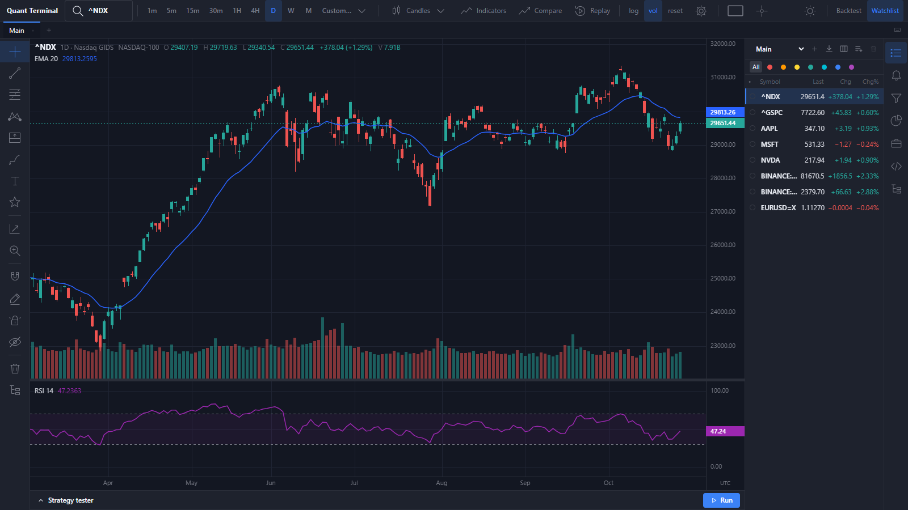

# Quant Terminal

Self-hosted charting and quant research terminal that runs on your own machine: candlestick charts on its own
canvas engine, technical indicators, a large set of drawing tools, multi-chart layouts, watchlists, alerts,
a screener, portfolios, paper trading, user scripts and a backtesting engine with fees, slippage and drawdowns.



> **Market data notice.** Quant Terminal ships **without any commercial or licensed datafeed**: no API keys, no
> paid subscriptions, no exchange data agreements. Out of the box it reads public, keyless endpoints of Yahoo
> Finance and Binance, and optionally your own MetaTrader 5 terminal. Only the MT5 bridge gives tick-by-tick
> real-time prices; Yahoo data can be delayed and is never a broker feed. See [Market data](#market-data) for
> the details and limitations before relying on any price shown.

## Features

- **Charts:** candles, hollow candles, bars, line, area, baseline, columns, Heikin-Ashi, Renko, Kagi, Line Break,
  Point & Figure and Range; log and auto scale, symbol compare, custom intervals, bar replay, dark and light themes.
- **Indicators and studies:** SMA, EMA, WMA, Bollinger Bands, Donchian, VWAP, RSI, MACD, Stochastic, ATR, OBV and
  volume, plus volume profile, pivots, auto Fibonacci and candlestick / chart pattern detection.
- **Drawing tools:** lines, channels, pitchforks, Fibonacci and Gann tools, Elliott waves, harmonic patterns,
  cycles, shapes, brushes, text and notes, icons, long/short position and measuring tools; anchors are stored in
  price/time so drawings survive zoom, timeframe changes and reloads; templates, visibility per interval, object tree.
- **Workspace:** tabs and multi-chart grids with linked symbol, interval and crosshair; layouts and watchlists are
  autosaved to a local JSON store.
- **Alerts:** price, indicator and drawing conditions, browser notifications, sounds and webhooks.
- **Research:** screener over built-in universes, portfolios with transactions, simulated paper trading, and
  user scripts (indicators and strategies) running in a sandboxed Web Worker.
- **Backtesting:** bar-by-bar engine without look-ahead, commission, slippage and spread, position sizing,
  stop-loss / take-profit, equity and drawdown curves, Sharpe, Sortino, Calmar and more, parameter sweeps and
  walk-forward tests.
- **Export:** chart PNG and CSV of bars and indicator values.

## Run

Double-click **`Start Terminal.cmd`** (or **`Start Terminal (MT5).cmd`** for live prices from a running MetaTrader 5).
It builds the app, starts the local server and opens **http://localhost:4180** in your browser.

From a terminal:

```
npm install
npm run build
npm start          # http://localhost:4180
```

> Opening `web/index.html` directly does not work: it is the build template, and the app needs the local
> server for data. Always use the launcher (or `npm run build && npm start`).

Development with hot reload: `npm run dev`, then open http://localhost:5180.

### Requirements
- Node.js 20+
- Optional, for the MT5 feed: Windows, MetaTrader 5 installed, running and logged in, and 64-bit Python 3.12
  (`bridge\setup.cmd` once)

## Market data

The server picks a source per symbol. Everything is cached on disk in `data/cache` (not part of the repo).

| Source | Symbols | Key needed | Real-time? |
|---|---|---|---|
| Yahoo Finance (public chart endpoint) | stocks, ETFs, indices (`AAPL`, `^NDX`), FX (`EURUSD=X`), anything else | no | **no**: delayed or indicative, polled |
| Binance (public REST API) | crypto pairs (`BTCUSDT`, `BINANCE:ETHUSDT`) | no | prices are live at the source, but the app polls |
| MetaTrader 5 (local bridge) | `MT5:<broker symbol>`, optionally all FX pairs | no (your own logged-in terminal) | **yes**: tick stream |

### No datafeed API included

There is no paid or licensed market-data provider in this project, and nothing is connected to one. Yahoo and
Binance are used through their public endpoints without an account. If you need guaranteed, licensed real-time
data, add a provider in `server/src/providers/` (the `Provider` interface: symbol search, bars, quotes) and route
symbols to it in `server/src/providers/index.ts`.

### Yahoo Finance limitations

Yahoo's chart endpoint is unofficial and undocumented. It has no service level, can change or break without
notice, rate-limits heavy use (the app then reports "Yahoo rate limit reached"), and Yahoo's terms allow personal
use only. In practice:

- **Not tick data, not a broker feed.** The app polls for new bars (see below) and there is no bid/ask, spread or
  market depth.
- **Stocks:** US-listed stocks are usually close to real time during regular hours, but the price comes from
  Yahoo's own feed, not a full consolidated tape, so last price and intraday volume can differ from your broker.
  Many non-US exchanges and some indices are **delayed by 15–20 minutes** or more (Yahoo lists the delay per
  exchange). Pre- and post-market bars are only included when extended hours are switched on.
- **Forex (`EURUSD=X` and pairs routed to Yahoo):** rates are **indicative**: an aggregated mid price, not a
  tradable bid/ask from a liquidity provider. They update less often than a broker feed, volume is zero, and
  candles can differ from your broker's (different price source and session times; bars here are in UTC).
  For live FX, use the MT5 bridge.
- **Intraday history is short:** about 7 days of 1-minute bars, 60 days of 5 to 30-minute bars and 730 days of
  1-hour bars. Daily and longer intervals go back to the listing date.
- **Refresh rate in this app:** charts poll every 5 s (intraday) or 30 s (daily and longer), but the server reuses
  the latest page for up to **30 s** on intraday intervals and **15 min** on daily and longer intervals; watchlist
  quotes refresh every 10 s. Yahoo prices on screen can therefore lag the source by up to these intervals, on top
  of any exchange delay.

### Binance limitations

Binance prices are real time at the source, but the app polls the public REST API with the same refresh rates as
above (there is no Binance websocket stream), so a candle can lag by up to 30 s. `api.binance.com` is not
reachable from some regions (for example the US). Only crypto pairs listed on Binance are available.

## MetaTrader 5 bridge (live prices)

`bridge/mt5_bridge.py` relays market data from a MetaTrader 5 terminal running on the same machine. It uses the
official `MetaTrader5` Python package, which talks to the installed terminal; whatever account that terminal is
logged into (demo or live) supplies the prices, so you see exactly your broker's quotes and symbols.

```
MT5 terminal  ──>  bridge (Python, 127.0.0.1:4191)  ──>  Quant Terminal server (:4180)  ──>  browser
                     /symbols /bars /quotes /stream        /api/bars /api/quotes /api/stream (SSE)
```

- **Real time:** `/stream` pushes every tick change as Server-Sent Events; the server relays it on
  `GET /api/stream?symbols=MT5:EURUSD,...` and the watchlist and charts update tick by tick. Polling stays as the
  resync after a reconnect.
- **Read-only by construction:** the `MetaTrader5` module is wrapped in an allow-list of market-data functions
  (symbols, ticks, rates). Order and position functions raise when called, so the bridge cannot trade or read
  account details. It only listens on 127.0.0.1.
- **Time zones:** MT5 reports broker server time. The bridge measures the offset from live ticks and returns UTC;
  daily, weekly and monthly bars are stamped at UTC midnight of the trading date, like the other sources.
- **Symbols:** use `MT5:<broker name>`, for example `MT5:EURUSD` or a broker-specific name such as `MT5:AAPL.NAS`.
  Availability depends on your broker. Set `QT_FX_PROVIDER=mt5` (the MT5 launcher does this) to also route
  `EURUSD=X`, `FX:EURUSD` and `OANDA:EURUSD` to MT5 instead of Yahoo.
- **History depth** follows the terminal's "Max bars in chart" setting and what the broker provides.

### Setup
1. Install MetaTrader 5, log in to an account (a demo account works) and keep the terminal open.
2. Run `bridge\setup.cmd` once (creates `bridge\.venv` with 64-bit Python 3.12 and installs `MetaTrader5`).
3. Start everything with `Start Terminal (MT5).cmd`.

The bridge port can be changed with `MT5_BRIDGE_PORT`, and the server's bridge address with `MT5_BRIDGE_URL`
(default `http://127.0.0.1:4191`).

## Project layout

- `core/`: pure TypeScript shared by server and web: types, indicators, chart transforms, drawing geometry,
  backtesting.
- `server/`: Node HTTP API on port 4180 (market data, disk cache, JSON store, alerts, screener, portfolios,
  paper trading); also serves the built web app.
- `web/`: React + Vite app with its own canvas chart engine (`web/src/chart/`).
- `bridge/`: the MetaTrader 5 market-data bridge.
- `tools/`: browser end-to-end checks and screenshot sheets.

Commands: `npm test` · `npm run typecheck` · `npm run build` · `npm run dev`.

## Docs
`docs/SPEC.md` (specification) · `docs/PLAN.md` (status) · `docs/ROADMAP.md` (next features) ·
`CHANGELOG.md` · `AGENTS.md` (conventions)

## Disclaimer

For research and education. Prices may be delayed, incomplete or wrong; nothing here is investment advice, and
backtest and paper-trading results do not predict real results.
